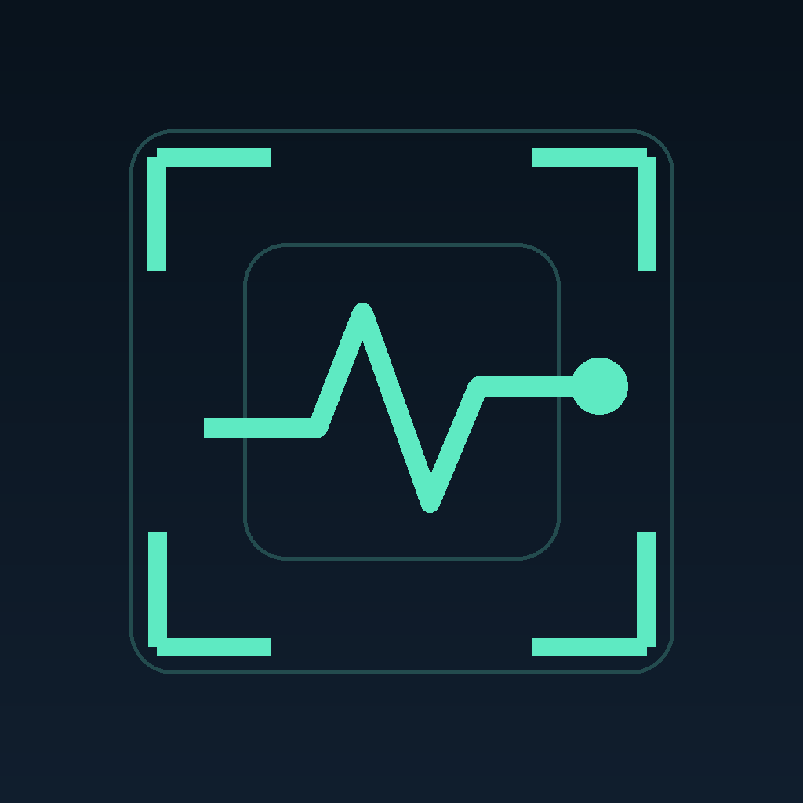
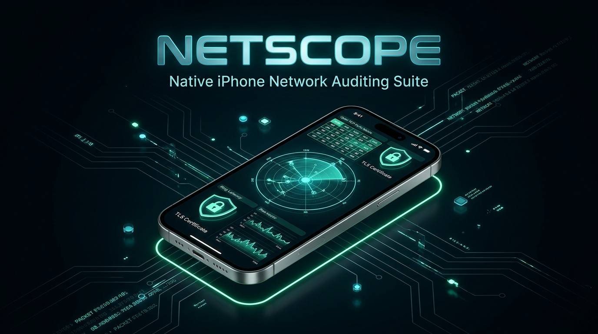
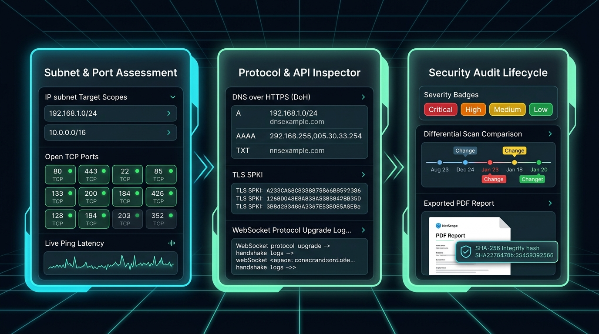
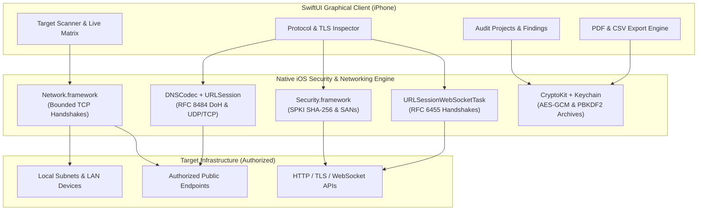

<p align="center">
  
</p>

<h1 align="center">NetScope</h1>

<p align="center">
  <b>Native, 100% Free iPhone Network Auditing & Security Assessment</b><br>
  <i>A graphical network reconnaissance, deep protocol diagnostic, and security compliance suite for iOS.</i>
</p>

<p align="center">
  <a href="https://github.com/Shashi552/netscope/watchers"></a>
  <a href="https://github.com/Shashi552/netscope/stargazers"></a>
  <a href="https://github.com/Shashi552/netscope/network/members"></a>
  <a href="https://github.com/Shashi552/netscope"></a>
</p>

<p align="center">
  <a href="https://github.com/Shashi552/netscope/actions/workflows/build-ipa.yml"></a>
  
  
  
  
  
  
</p>

---

<p align="center">
  
</p>

---

## ⚡ Overview

**NetScope** is engineered from the ground up for iOS security engineers, system administrators, and privacy advocates who need an honest, capable, and completely offline network auditing suite in their pocket.

* **100% Free Forever:** No subscriptions, in-app purchases, ads, paywalls, or commercial backend tiers.
* **100% On-Device & Private:** Never uploads your network layout or credentials. Zero analytics SDKs.
* **Pure Apple Frameworks:** Built exclusively with `SwiftUI`, `Network.framework`, `URLSession`, and `Security.framework` without bloated third-party dependencies.

<p align="center">
  
</p>

---

## 🚀 Key Modules

### 1. Subnet & Port Assessment
* **Scope Parser:** Target hostnames, IPv4, IPv6, CIDR blocks (`/20` through `/32`), and hyphenated ranges (`192.168.1.1-192.168.1.100`).
* **Presets & Custom Ports:** Quick profiles for Web, Common (Top 30), or arbitrary port ranges up to 65,535.
* **Continuous Background Keep-Alive:** Inaudible silent audio loop (`AVAudioSession` `.playback` mode + `UIBackgroundModes: audio`) ensures long subnet sweeps and scans run continuously without interruption when locking your iPhone or switching apps. Sends a local notification on scan completion.
* **Adaptive Concurrency & Backoff:** Rate-limited concurrent TCP-connect probes that gracefully back off on timeouts or network congestion.
* **Checkpoint & Resume:** State is persisted incrementally; resume interrupted assessments across app launches.

### 2. Deep Protocol & API Diagnostics
* **DNS over HTTPS (DoH) & UDP/TCP:** Supports RFC 8484 wireformat DoH queries, RFC 1035 **SOA record decoding** (serial, master, mailbox, timers), compression-loop safeguards, and two-resolver answer comparison.
* **WebSocket Handshake Verification:** Validates RFC 6455 HTTP upgrade responses, subprotocol negotiation, and measures bidirectional ping round-trip latency.
* **TLS Deep Inspection & SPKI Pinning:** Extracts **Subject Alternative Names (SANs)**, validity dates, certificate SHA-256 fingerprints, and Subject Public Key Info (**SPKI SHA-256**) for baseline public-key diffing.
* **HTTP / API Inspector:** Pretty-printed JSON response explorer, method assertions, side-by-side response comparison, origin binding, and Keychain vault integration.
* **Service Greeting Reader:** Captures banner output from SSH, FTP, and SMTP services with differential highlighting against previous scans.
* **OpenAPI Explorer:** Local bounded JSON schema viewer with automated alerts for state-changing endpoints.

### 3. Security Audit Lifecycle & Reporting
* **Audit Workspaces:** Organize targets, project scopes, client boundaries, and assessment checklists.
* **Findings Tracker:** Triage security items with transparent CVSS-like priority scoring, confidence metrics, and host/severity grouping.
* **Exception Expiry Reminders:** Schedules local device notifications 7 days before temporary security exceptions expire.
* **Baseline Differential Audits:** Compare two scans side-by-side to immediately spot newly opened ports or altered service greetings.
* **Executive Reports:** Generate branded, paginated PDF summaries with target redaction and automated SHA-256 evidence integrity manifests.
* **Encrypted Archives:** PBKDF2-HMAC-SHA256 and AES-GCM 256-bit password-protected audit vaults.

---

## 🏗 Architecture



---

## 📲 Quick Install on iPhone

Download the latest pre-compiled **[NetScope.ipa](https://github.com/Shashi552/netscope/releases/latest)**:

* **LiveContainer (Recommended — JIT-less / No 7-Day Revokes):**
  1. Download `NetScope.ipa` to the iPhone **Files** app.
  2. Open **LiveContainer** → tap **+** (**Import IPA**) → select `NetScope.ipa`.
  3. Tap **NetScope** to launch.
* **Sideloadly / AltStore (Free Apple ID):**
  1. Connect your iPhone to your Mac or PC.
  2. Drag `NetScope.ipa` into Sideloadly / AltStore, sign in with your Apple ID, and install.
  3. Trust your developer profile under **Settings → General → VPN & Device Management**.
* **TrollStore (iOS 14.0–16.6.1 / 17.0):**
  1. AirDrop or open `NetScope.ipa` directly in TrollStore and tap **Install**.

---

## 🛡 Honest Platform Boundaries

NetScope is strictly built within the boundaries of Apple's documented iOS sandbox:
* **No Raw SYN Scans:** iOS sandboxing denies `SOCK_RAW`. All connections use standard TCP handshakes via `Network.framework`.
* **No ARP / MAC Harvesting:** Apple blocks MAC address lookups on iOS 11+; targets are tracked by IP/DNS.
* **Foreground-Only Execution:** Probes immediately pause when the app is backgrounded to protect data integrity and avoid silent OS termination.
* **Defensive Only:** No exploit execution, credential dictionary brute-forcing, or unvetted scripts.

---

## 🧪 Automated Verification Suite

NetScope includes automated unit and integration tests covering scope expansion, DNS codecs, compression loop guards, encrypted archive round-trips, and WebSocket models.

Run the test suite on any macOS system:
```bash
swiftc -parse-as-library -o /tmp/netscope_tests \
  Scripts/run_standalone_tests.swift \
  Sources/Models.swift \
  Sources/Networking/Scope.swift \
  Sources/Networking/DNSClient.swift \
  Sources/Networking/HTTPInspector.swift \
  Sources/Networking/SocketExchange.swift \
  Sources/Networking/WebSocketInspector.swift \
  Sources/Audit/SecurityTools.swift \
  Sources/Audit/AuditModels.swift \
  Sources/Audit/ProbeProfile.swift \
  Sources/ScanStore.swift \
  Sources/TCPScanner.swift && /tmp/netscope_tests
```
```
=== Running NetScope Test Suite ===
[RUN] ScanInputTests
[RUN] ScopeAndCodecTests
[RUN] ArchiveAndComparisonTests
[RUN] WebSocketTests

=== Test Results Summary ===
Total Assertions: 75
Passed: 75
Failed: 0
ALL TESTS PASSED SUCCESSFULLY!
```

---

## 🛠 Building from Source

### Cloud Build (GitHub Actions)
Push changes to your repository. The included `.github/workflows/build-ipa.yml` compiles on `macos-15` (Xcode 16 / iOS 18 SDK) and outputs `NetScope.ipa` in under 2 minutes.

### Local Mac Build (Xcode 15+)
```bash
# 1. Open project
open NetScope.xcodeproj

# 2. Package .ipa locally
./Scripts/build-ipa.sh
```

---

## 📄 License

MIT License. See [LICENSE](LICENSE) for details.
